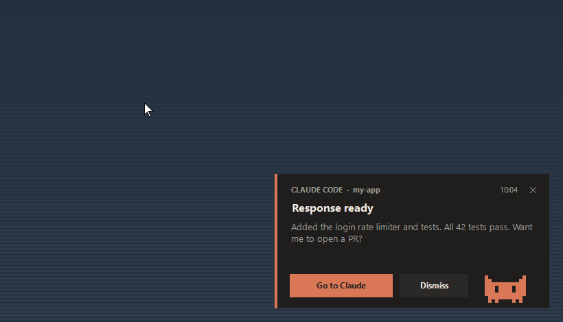
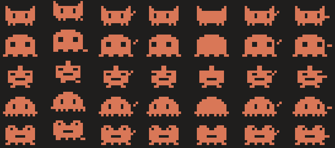
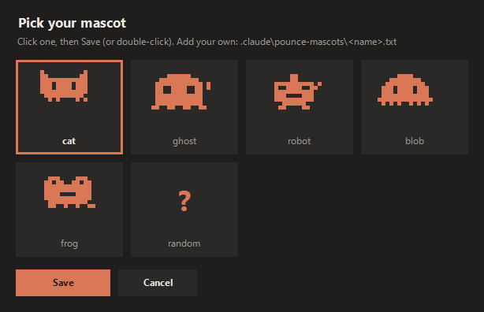
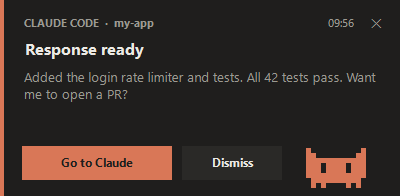

# pounce

A desktop notification card for [Claude Code](https://docs.claude.com/en/docs/claude-code) on Windows, with a pixel pet that jumps out of the card and bats your mouse pointer until you notice it.

> Unofficial. Not affiliated with, endorsed by, or sponsored by Anthropic.



> **Windows only for now.** Want macOS or Linux support? [Open an issue](../../issues/new/choose) and say which platform and desktop you use.

## What it does

When Claude Code finishes a reply (`Stop` hook) or needs your permission (`Notification` hook), pounce:

- shows a dark card in the bottom-right corner with the project folder and a short plain-text snippet of Claude's reply
- flashes the terminal's taskbar button
- after about 1 second, sends the pet out to chase your pointer and bat it 3 times (about 10 px per hit), then back to the card. While the card stays open, it does this again every ~18 seconds
- **Go to Claude** (or Enter) brings your terminal to the front without changing its maximized/normal state. **Dismiss**, Esc, or the close button closes the card
- closes the card by itself when you switch back to the terminal
- shows nothing if the terminal is already the active window

The pet window is click-through and never takes focus, so it can't eat your clicks.

## Mascots



`cat` (default), `ghost`, `robot`, `blob`, `frog`, or `random`. Each one idles (hop, wave, wiggle, look around, blink) and has paw-up / paw-hit poses for pouncing.

### Pick one

```powershell
powershell.exe -NoProfile -ExecutionPolicy Bypass -File "$env:USERPROFILE\.claude\pounce.ps1" -Pick
```



The picker shows every mascot animating side by side. Click one, then **Save**, or double-click it. The choice is saved to `%USERPROFILE%\.claude\pounce-mascot.txt`, and every card uses it unless the hook passes `-Mascot`.

### Custom mascot

Drop a text file into `%USERPROFILE%\.claude\pounce-mascots\<name>.txt`. It appears in the picker under that name, and also works as `-Mascot <name>` (a full file path works too). Use `#` for body, `o` for eyes (they blink and look around), and `.` for empty cells. The last row is the feet, which shuffle when it walks. Keep it around 14-18 columns wide.

```
.#..........#.
.##........##.
.############.
.###o####o###.
.###o####o###.
.############.
..##########..
..#.#....#.#..
```

Only publish a custom sprite if you have the rights to it. Brand mascots usually belong to their owners.

## Install

Requirements: Windows 10/11 and Windows PowerShell 5.1 (`powershell.exe`, built in).

1. Copy `pounce.ps1` to `%USERPROFILE%\.claude\pounce.ps1`.
2. Add the hooks to `%USERPROFILE%\.claude\settings.json`. Replace `YOU` with your Windows user name, and merge with any `hooks` you already have:

```json
{
  "hooks": {
    "Stop": [
      {
        "hooks": [
          {
            "type": "command",
            "command": "powershell.exe",
            "args": ["-NoProfile", "-ExecutionPolicy", "Bypass", "-File", "C:\\Users\\YOU\\.claude\\pounce.ps1"],
            "async": true
          }
        ]
      }
    ],
    "Notification": [
      {
        "matcher": "permission_prompt|elicitation_dialog",
        "hooks": [
          {
            "type": "command",
            "command": "powershell.exe",
            "args": ["-NoProfile", "-ExecutionPolicy", "Bypass", "-File", "C:\\Users\\YOU\\.claude\\pounce.ps1"],
            "async": true
          }
        ]
      }
    ]
  }
}
```

The `matcher` limits Notification to permission and input prompts. That avoids a second card from the idle reminder Claude Code sends after you leave a finished reply unanswered.

### Options

| Argument | Effect |
|---|---|
| `-Pick` | open the mascot picker and save your choice |
| `-Mascot <name or path>` | override the saved pick: `cat`, `ghost`, `robot`, `blob`, `frog`, `random`, a custom name, or a sprite file |
| `-NoSwat` | the pet stays in the card and never moves your pointer |

### Try it

```powershell
$env:POUNCE_FORCE = '1'   # show the card even though the terminal is focused
'{"hook_event_name":"Stop","cwd":"C:/dev/demo","last_assistant_message":"Hello from pounce"}' |
  powershell.exe -NoProfile -ExecutionPolicy Bypass -File .\pounce.ps1 -Mascot random
```

## Notes

- The file is kept ASCII-only, because Windows PowerShell 5.1 reads files without a BOM as ANSI.
- Hook input fields used: `hook_event_name`, `cwd`, `message`, `last_assistant_message`.
- Tested on Windows 11 with Cursor and Windows Terminal.



## Platform support

| Platform | Status |
|---|---|
| Windows 10 / 11 | Supported |
| macOS | Not yet. [Open an issue](../../issues/new/choose) if you need it |
| Linux | Not yet. [Open an issue](../../issues/new/choose) if you need it, and include your desktop (GNOME, KDE, ...) and X11 or Wayland |

## Contributing

Bug reports, new mascots, and platform ports are welcome. See [CONTRIBUTING.md](CONTRIBUTING.md).

## License

MIT. See [LICENSE](LICENSE).

"Claude" and "Claude Code" are trademarks of Anthropic, PBC. They are used here only to describe compatibility. The mascots in this repository are original pixel art made for this project.
